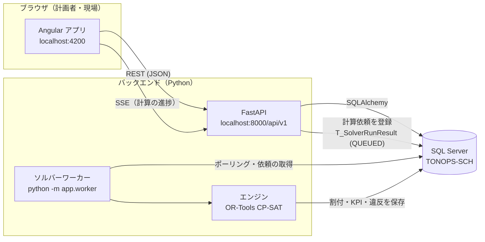
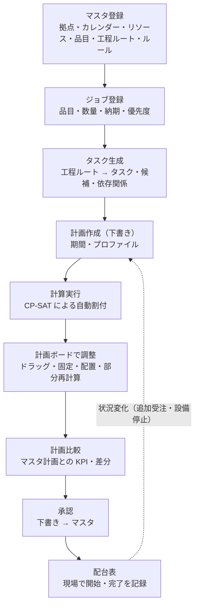
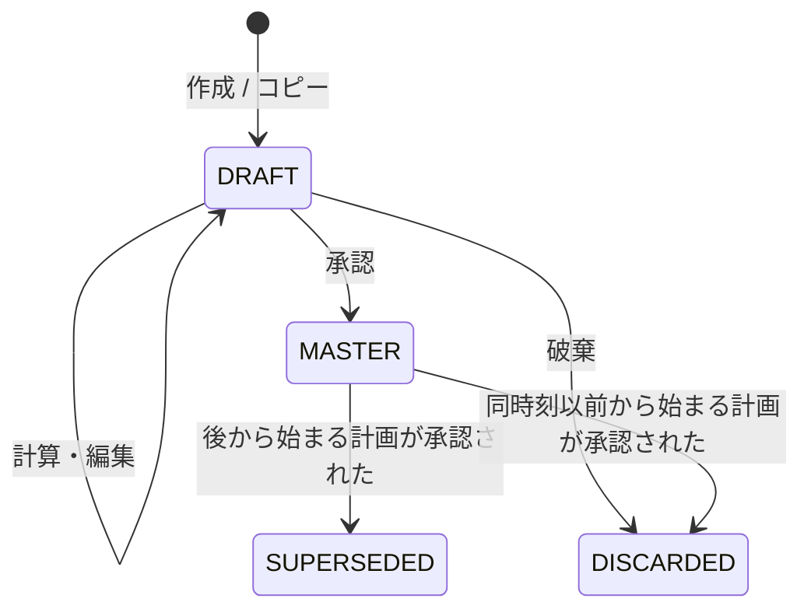
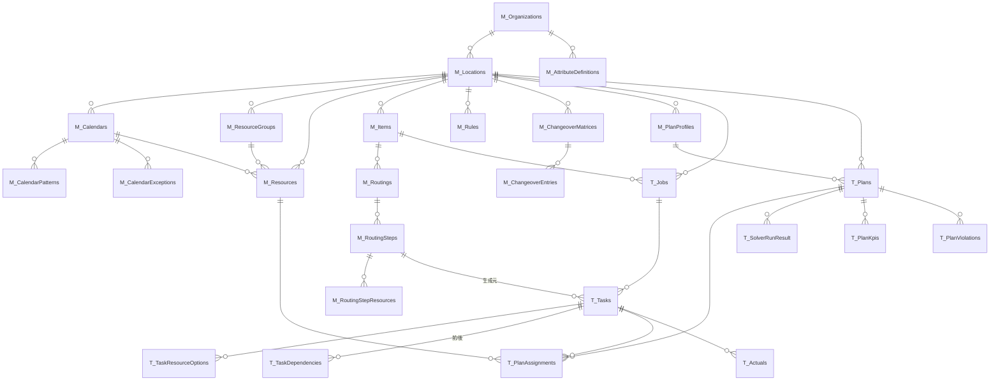

<!-- SCH全体の構成、業務仕様、データ構造、APIと画面の対応をまとめる資料。 -->
# TONOPS-SCH システム概要

TONOPS-SCH は、業種に依存しない **生産・プロジェクト スケジューラ** です。
「どのタスクを・どのリソース（設備・人・チーム・部屋など）で・いつ行うか」を、
稼働カレンダー・工程順序・段取り替え・制約ルールを守りながら自動で計画し、計画者が画面で調整・承認します。

旧システム ADK-SCH1（マーガリン・ショートニング・ホイップ専用）の考え方を一般化したもので、
食品固有の用語（アレルゲンなど）は **属性（AttributesJSON）とルール** で表現します。

| 項目 | 内容 |
|---|---|
| フロントエンド | Angular 21 + DayPilot Lite（[TONOPS-SCH-frontend](https://github.com/tds-dev/TONOPS-SCH-frontend)） |
| バックエンド | Python / FastAPI（[TONOPS-SCH-backend](https://github.com/tds-dev/TONOPS-SCH-backend)） |
| 最適化エンジン | Google OR-Tools CP-SAT |
| データベース | SQL Server（DB 名 `TONOPS-SCH`） |
| 認証 | 未実装（今後 Firebase 認証を予定） |

---

## 目次

1. [システム構成](#1-システム構成)
2. [用語](#2-用語)
3. [業務の流れ](#3-業務の流れ)
4. [スケジューリングロジック](#4-スケジューリングロジック)
5. [計画のライフサイクル（承認・置換）](#5-計画のライフサイクル承認置換)
6. [データベーススキーマ](#6-データベーススキーマ)
7. [画面とテーブルの対応](#7-画面とテーブルの対応)
8. [API 一覧](#8-api-一覧)
9. [日時・タイムゾーンの扱い](#9-日時タイムゾーンの扱い)
10. [KPI と違反コード](#10-kpi-と違反コード)
11. [拡張方法（ルールプラグイン・属性）](#11-拡張方法ルールプラグイン属性)
12. [他システムとの連携（予定）](#12-他システムとの連携予定)
13. [現在の制約・今後の予定](#13-現在の制約今後の予定)

---

## 1. システム構成



* **API** は画面からのリクエストを処理します。計算（数十秒〜数分）は API の中では行わず、
  `T_SolverRunResult` に依頼（`QUEUED`）を登録してすぐに返します。
* **ソルバーワーカー** は `T_SolverRunResult` を数秒ごとに確認し、依頼を 1 件ずつ取り出して
  （条件付き UPDATE で `RUNNING` に変更 = 二重実行防止）計算します。進捗は `ProgressJSON` に書き込みます。
* **画面** は計算の進捗を Server-Sent Events（`GET /solver-runs/{id}/events`）で受け取り、完了したらボードを再読み込みします。
* ワーカーは複数起動できます（依頼の取得は排他制御済み）。キューは DB のテーブルなので、Redis などは不要です。

### バックエンドの層

```
routers（REST の入出力） → services（業務ロジック・トランザクション） → models（SQLAlchemy）
                                     ↓
                       engine/snapshot.py（DB → Problem）
                       engine/model_builder.py（Problem → CP-SAT → 解）
                       engine/evaluate.py（違反・KPI）   ← 純粋関数（DB 非依存）
                       engine/edit.py / compare.py（手動編集・比較）
```

エンジンの中心部（`problem` / `model_builder` / `evaluate` / `edit` / `compare` / `rules`）は DB に依存しないため、
データベースへの接続を伴わずに計算できます。

---

## 2. 用語

| 用語 | テーブル | 説明 |
|---|---|---|
| 組織 | M_Organizations | 会社。属性定義の単位 |
| 拠点 | M_Locations | 工場・事業所。タイムゾーンと既定カレンダーを持つ。左サイドバーのアプリ名の下で切り替え |
| カレンダー | M_Calendars ほか | 稼働時間（週次のシフト＋例外）。リソースごとに設定、未設定なら拠点の既定 |
| リソースグループ | M_ResourceGroups | 同種のリソースのまとまり（例: 配合、充填、包装） |
| リソース | M_Resources | 作業を行うもの。設備・人・チーム・部屋など（`ResourceKind`） |
| 品目 | M_Items | 製品・成果物。属性（例: 系統 family）を持つ |
| 工程ルート | M_Routings / M_RoutingSteps | 品目を作る手順（工程の並びと待ち時間） |
| ジョブ | T_Jobs | 需要の単位。受注（ORDER）またはプロジェクト（PROJECT）。納期・優先度を持つ |
| タスク | T_Tasks | スケジュールの最小単位。ジョブの工程ルートから生成、または直接登録 |
| リソース候補 | T_TaskResourceOptions | タスクを実行できるリソース（またはグループ）と所要時間 |
| 依存関係 | T_TaskDependencies | タスク間の順序（FS/SS/FF/SF とラグ） |
| 計画 | T_Plans | スケジュールの 1 つの版。下書き → マスタ（承認） |
| 割付 | T_PlanAssignments | 計画内で「タスク × リソース × 時刻」を決めたもの |
| 計算（ソルバー実行） | T_SolverRunResult | エンジンによる自動計画の 1 回分。作業キューも兼ねる |
| 段取り替え | M_ChangeoverMatrices | 同じリソースで属性値が変わるときに必要な時間（例: 系統 A→C は 45 分） |
| 制約ルール | M_Rules | プラグインで実装された追加の制約（例: 系統 C は平日のみ） |
| 計画プロファイル | M_PlanProfiles | 目的関数の重み・計算時間の上限など、計算の方針 |
| ロック（固定） | PlanAssignment.IsLocked | 再計算で動かさない割付。手動で動かした割付は既定でロック |
| マスタ計画 | T_Plans.Status = MASTER | 承認済みで現場が使う計画。配台表の元データ |

---

## 3. 業務の流れ



1. **マスタ登録**: フロントエンドの「設定」からリソース、カレンダー、品目・工程ルート、制約ルール・段取り替えを登録（API / Swagger からも登録可能）。組織・拠点・計算プロファイルの登録は引き続き API / Swagger を使用。
2. **ジョブ登録** → **タスク生成**: ジョブの品目の工程ルートを展開し、工程ごとにタスク、リソース候補、前後の依存関係を作ります。
   所要時間 = 工程リソース候補の `SetupMinutes` + `FixedMinutes` + 数量 × `MinutesPerUnit`（分、切り上げ）。
3. **計画作成**: 計画期間（拠点の現地時刻）とプロファイルを指定。現在のマスタ計画が「元計画（BasePlanID）」になります。
4. **計算実行**: ワーカーが CP-SAT で割付を計算し、KPI と違反（課題）を保存します。
5. **調整**: 計画ボードでドラッグ（移動・リサイズ）、固定・解除、割付を外す、未割付タスクの配置。
   保存の前にサーバーで検証し、適用できない変更は元に戻します。手動で動かしたタスクは固定され、
   その後の **部分再計算** では動かさずに残りを組み直します。
6. **比較・承認**: マスタ計画と KPI・変更タスクを比較し、承認するとマスタ計画になります。
7. **配台表**: 現場がタブレットでマスタ計画の 1 日分を見て、開始・完了を記録します（`T_Tasks.Status`）。

---

## 4. スケジューリングロジック

### 4.1 入力の組み立て（`engine/snapshot.py`）

計算時に DB から次を読み込み、エンジン用の `Problem` を作ります。時刻はすべて **計画期間の開始からの整数分** に変換します。

| 入力 | 読み込み元 | 内容 |
|---|---|---|
| リソース | M_Resources（論理削除を除く） | 能力（Capacity）、稼働枠 |
| 稼働枠 | M_Calendars / M_CalendarPatterns / M_CalendarExceptions | リソースのカレンダー（なければ拠点の既定、それもなければ常時稼働）を計画期間に展開。親カレンダー（ParentCalendarID）を継承 |
| ジョブ | T_Jobs | 拠点が一致、未削除、`DONE`/`CANCELLED` 以外、`PlanOwner = SCHEDULER`、着手可能日時が期間終了より前 |
| タスク | T_Tasks | 上記ジョブのタスクのうち、サマリーでなく `DONE`/`CANCELLED` 以外 |
| 候補 | T_TaskResourceOptions | グループ指定の候補はグループ内の全リソースに展開 |
| 依存関係 | T_TaskDependencies | |
| 段取り替え | M_ChangeoverMatrices / M_ChangeoverEntries | 有効なもの。グループ指定ならそのグループのリソースに適用 |
| ルール | M_Rules | 有効かつ計画開始日（現地）が有効期間内のもの |
| 重み・上限 | M_PlanProfiles | `ObjectiveWeightsJSON`、`TimeLimitSec`、`FrozenWindowHours` |
| 前回の位置 | T_PlanAssignments | この計画の割付、なければ元計画（マスタ）の割付 |

**前回の位置の扱い**

* この計画（または元計画）で **ロックされた割付** → 位置を固定（ソルバーは動かさない）
* 元計画の割付のうち **確定期間（FrozenWindowHours）内に始まるもの** → 固定
* それ以外 → 初期解のヒント（解の探索を速くする。安定性の重みがあれば、ずらすほどペナルティ）
* 確定期間内には新しい作業を開始しません。

### 4.2 CP-SAT モデル（`engine/model_builder.py`）

| 要素 | モデル化 |
|---|---|
| タスク | 開始・終了の整数変数と「割り付けるか」のフラグ。候補リソースごとに任意区間（Optional Interval）を作り、割り付ける場合は **ちょうど 1 つ** を選ぶ |
| 着手可能日時 | 開始 ≥ ジョブの ReleaseAt / タスクの EarliestStartAt / 確定期間の終わり |
| リソースの重なり | 能力 1: `AddNoOverlap`（同時に 1 作業）。能力 > 1: `AddCumulative` |
| 稼働時間 | 非稼働時間を「固定のブロック区間」としてリソースに追加 → タスクは 1 つの稼働枠に収まる（休憩や夜間をまたいで分割はしない） |
| 依存関係 | FS（前の終了→後の開始）、SS、FF、SF。最小ラグ（LagMin）と最大ラグ（MaxLagMin）。後工程を割り付けるなら前工程も割り付ける |
| 段取り替え | リソースごとに `AddCircuit`（作業の並び順）。順序 i→j を選んだら「j の開始 ≥ i の終了 + 段取り時間」。禁止の組合せ（IsForbidden）は順序の候補から除外。1 リソースの候補が 80 件を超える場合は段取りを無視（ログに注記） |
| ロック | 開始・終了・リソースを固定。非稼働時間に置かれたロックもそのまま受け入れる |
| ルール | プラグインが制約を追加（例: `allowed_weekdays` は許可されない曜日をブロック区間として追加） |

段取り時間の照合（`M_ChangeoverEntries`）: 同じ値どうしは 0 分（明細があればその値）。
異なる値は `(From, To)` → `(From, *)` → `(*, To)` → `(*, *)` の順に探し、なければマトリクスの `DefaultMinutes`。

### 4.3 目的関数（最小化）

| 項目 | 既定の重み | 内容 |
|---|---|---|
| `unscheduled` | 100000 | 割り付けられなかったタスク 1 件あたり |
| `lateness` | 1000 | ジョブの納期遅れ（分）× 優先度の倍率。未割付タスクは「期間の終わりに完了」とみなす（外す方が得にならないように） |
| `setup` | 10 | 段取り時間（分）の合計 |
| `makespan` | 1 | 最終作業の終了時刻（分） |
| `stability` | 0（部分再計算は 20） | 前回の位置からのずれ（分）。リソースの変更は 60 分のずれとみなす |

優先度の倍率: `Priority` 1（最優先）= 4.9 倍、50 = 3.0 倍、100 = 1.0 倍。
タスクに期限（DeadlineAt）がある場合は、その超過分も `lateness` の重みで加算します。

重みは計画プロファイルの `ObjectiveWeightsJSON` で上書きできます（例: `{"lateness": 1000, "setup": 50}`）。

### 4.4 全体計算と部分再計算

| | 全体計算（FULL） | 部分再計算（REPAIR） |
|---|---|---|
| 用途 | 新しい計画を一から作る | 手動調整・追加受注の後、今の計画をなるべく保ったまま直す |
| ロック済み | 固定 | 固定 |
| その他の割付 | ヒントとして使うだけ | 安定性の重み 20（プロファイルで未指定の場合）→ 必要なものだけ動く |

### 4.5 計算の実行と結果（`engine/solve.py`、`app/worker.py`）

1. ワーカーが `QUEUED` の依頼を `RUNNING` にして取得
2. `build_problem` → `solve_problem`（上限 = 依頼の `TimeLimitSec`、既定はプロファイルの値）
3. 解が見つかるたびに `ProgressJSON`（解の数・目的値・下限・経過秒）を更新 → 画面の進捗バー
4. キャンセル（`POST /solver-runs/{id}/cancel`）は数秒ごとに確認し、それまでの最良解で終了
5. 結果: `OPTIMAL`（最適解）/ `FEASIBLE`（実行可能解）なら `SUCCEEDED`。
   この計画の `T_PlanAssignments` を置き換え（ロックは維持）、`T_PlanKpis` と `T_PlanViolations` を再計算。
   解なしは `FAILED`（`ErrorMessage` に理由）

### 4.6 検証と手動編集（`engine/evaluate.py`、`engine/edit.py`）

* **検証**: 割付の結果を独立したロジックで再確認し、違反を `T_PlanViolations` に保存します（[違反コード](#10-kpi-と違反コード)）。
  計算結果だけでなく、手動編集やロックによる問題も「課題」として表示されます。
* **手動編集**（ボードのドラッグなど）:
  1. 画面が `POST /plans/{id}/assignments/validate` で変更を検証（保存しない）
  2. 適用できない変更（候補にないリソース、期間外など）→ 画面で元に戻す
  3. **新たに** 必須制約の違反が出る → 確認ダイアログ → 「保存する」で `force: true`
  4. `PATCH /plans/{id}/assignments` で保存。変更したリソースの段取りを計算し直し、KPI と違反を更新
  5. 移動したタスクは既定でロック（`lockMoved`）、`Source = MANUAL`
* **楽観的排他制御**: 計画と割付は `RowVer`（整数）を持ち、画面が読んだ版と DB が違えば 409（他の人が更新済み）。

---

## 5. 計画のライフサイクル（承認・置換）



| 状態 | 表示 | 説明 |
|---|---|---|
| DRAFT | 下書き | 計算・編集できる唯一の状態 |
| MASTER | マスタ | 承認済み。現場（配台表）が使う |
| SUPERSEDED | 置換済 | 新しいマスタに途中から置き換えられた。`SupersededAt` より前の割付は引き続き有効 |
| DISCARDED | 破棄 | 使わない計画 |
| ARCHIVED | 保管 | 予約（未使用） |

**承認の処理**（`services/plan_lifecycle.py`）

* 条件: DRAFT、計算中でない、割付が 1 件以上、未割付以外の必須違反がない（ある場合は `force: true` が必要）。
* 拠点の行をロック（SQL Server では UPDLOCK）して、同じ拠点の承認を直列化します。
* 期間が重なる既存の MASTER:
  * 新しい計画より **前に始まる** → `SUPERSEDED`、`SupersededAt` = 新計画の開始
  * 新しい計画と **同時刻以降に始まる** → `DISCARDED`
* 割付のあるジョブは `OPEN` → `PLANNED`。

**「現在のマスタ計画」の割付**（配台表・ダッシュボード）= MASTER の割付 ＋ SUPERSEDED 計画のうち `SupersededAt` より前に始まる割付。
同じタスクが両方にあれば MASTER を優先します。これにより、計画を日々ローリングで更新しても、過去分の配台表は残ります。

**計画番号**: `P-YYYYMMDD-NN`（期間開始日（現地）＋拠点内の連番）。

---

## 6. データベーススキーマ

### 6.1 共通の規約

* `M_`（マスタ）/ `T_`（トランザクション）、列名は PascalCase、主キーは `<Entity>ID`（IDENTITY）。
* 監査列（全テーブル共通、`T_PlanKpis` を除く）: `CreatedAt`（UTC）、`CreatedBy`、`UpdatedAt`、`UpdatedBy`。
* 論理削除: `DeleteFlag`（BIT）を持つテーブルは DELETE API で論理削除。一覧は既定で削除済みを除外。
* 型（SQL Server）: 文字列 `NVARCHAR(n)`、長文 `NVARCHAR(MAX)`、日時 `DATETIME2`（naive UTC）、JSON 列は `NVARCHAR(MAX)`。
* 制約名: `PK_<表>`、`FK_<表>_<列>_<参照表>`、`UQ_<表>_<列>…`、`CK_<表>_<名前>`、`IX_<表>_<列>…`。
* 区分値は CHECK 制約で制限（下表の「値」）。
* 初期設定は `python -m DataBase.setup_database` でDB・テーブル作成とデモデータ登録を行います。SQLファイルへの出力機能はありません。

### 6.2 ER 図



### 6.3 マスタテーブル（M_）

#### M_Organizations（組織）
| 列 | 型 | 説明 |
|---|---|---|
| OrganizationID | INT PK | |
| OrganizationCode | NVARCHAR(30) UQ | |
| OrganizationName | NVARCHAR(100) | |
| DeleteFlag | BIT | |

#### M_Locations（拠点）
| 列 | 型 | 説明 |
|---|---|---|
| LocationID | INT PK | |
| OrganizationID | INT FK | |
| LocationCode / LocationName | NVARCHAR | 組織内で LocationCode 一意 |
| TimeZone | NVARCHAR(50) | IANA 名（既定 `Asia/Tokyo`）。画面の表示・入力はこの時刻 |
| DefaultCalendarID | INT FK NULL | リソースにカレンダーがない場合に使う |
| DeleteFlag | BIT | |

#### M_Calendars（カレンダー）
| 列 | 型 | 説明 |
|---|---|---|
| CalendarID | INT PK | |
| LocationID | INT FK | |
| CalendarCode / CalendarName | NVARCHAR | 拠点内で CalendarCode 一意 |
| ParentCalendarID | INT FK NULL | 親のパターン・例外を継承（例: 拠点共通 → ライン別） |
| DeleteFlag | BIT | |

#### M_CalendarPatterns（稼働パターン — 週次シフト、拠点の現地時刻）
| 列 | 型 | 説明 |
|---|---|---|
| PatternID | INT PK | |
| CalendarID | INT FK（CASCADE） | |
| DayOfWeek | SMALLINT | 1 = 月 … 7 = 日 |
| StartTime / EndTime | TIME | EndTime ≤ StartTime は日をまたぐ（例: 22:00–06:00） |
| ShiftName | NVARCHAR(50) | 例: 午前、夜勤 |
| ValidFrom / ValidTo | DATE NULL | 適用期間 |

#### M_CalendarExceptions（稼働例外）
| 列 | 型 | 説明 |
|---|---|---|
| ExceptionID | INT PK | |
| CalendarID | INT FK（CASCADE） | |
| StartAt / EndAt | DATETIME2（UTC） | |
| IsWorking | BIT | 0 = 休日・停止（稼働から除く）、1 = 残業・休日出勤（稼働に加える） |
| Reason | NVARCHAR(100) | |

#### M_ResourceGroups（リソースグループ）
| 列 | 型 | 説明 |
|---|---|---|
| ResourceGroupID | INT PK | |
| LocationID | INT FK | |
| GroupCode / GroupName | NVARCHAR | 拠点内で GroupCode 一意 |
| SortOrder | INT | 表示順 |
| DeleteFlag | BIT | |

#### M_Resources（リソース）
| 列 | 型 | 説明 |
|---|---|---|
| ResourceID | INT PK | |
| LocationID | INT FK | |
| ResourceGroupID | INT FK NULL | |
| ResourceCode / ResourceName | NVARCHAR | 拠点内で ResourceCode 一意 |
| ResourceKind | NVARCHAR(20) | 値: `MACHINE` `PERSON` `TEAM` `ROOM` `OTHER` |
| Capacity | DECIMAL(9,2) | 同時に処理できる作業数（1 = 重なり禁止） |
| DailyCapacityHours | DECIMAL(5,2) NULL | 予約（未使用） |
| CalendarID | INT FK NULL | なければ拠点の既定カレンダー |
| CostPerHour | DECIMAL(12,2) NULL | 予約（未使用） |
| AttributesJSON | NVARCHAR(MAX) | 任意の属性 |
| SortOrder | INT | ボードの表示順 |
| DeleteFlag | BIT | |

#### M_AttributeDefinitions（属性定義）
品目・リソース・ジョブ・タスクの `AttributesJSON` に入れる項目の定義（画面の入力欄やルールの対象に使う予定）。

| 列 | 型 | 説明 |
|---|---|---|
| AttributeDefID | INT PK | |
| OrganizationID | INT FK | |
| EntityType | NVARCHAR(20) | 値: `ITEM` `RESOURCE` `JOB` `TASK` |
| AttributeKey | NVARCHAR(50) | JSON のキー（例: `family`） |
| Label | NVARCHAR(100) | 表示名（例: 系統） |
| DataType | NVARCHAR(20) | 値: `TEXT` `NUMBER` `BOOL` `DATE` `ENUM` |
| EnumValuesJSON | NVARCHAR(MAX) | ENUM の選択肢 |
| IsRequired / SortOrder | BIT / INT | |

#### M_Rules（制約ルール）
| 列 | 型 | 説明 |
|---|---|---|
| RuleID | INT PK | |
| LocationID | INT FK | |
| RuleTypeKey | NVARCHAR(50) | プラグインの種類（`GET /rule-types` で一覧） |
| RuleName | NVARCHAR(100) | |
| SelectorJSON | NVARCHAR(MAX) | 対象タスクの条件（タスク属性で照合）。例 `{"family": "C"}`、`{"family": {"in": ["A","B"]}}`、`{}` = 全タスク |
| ParamsJSON | NVARCHAR(MAX) | プラグインのパラメータ（例 `{"weekdays": [1,2,3,4,5]}`） |
| IsHard | BIT | 1 = 必須（違反は HARD）、0 = 推奨（SOFT） |
| Weight | INT | 推奨ルールの重み（予約） |
| ValidFrom / ValidTo | DATE NULL | 有効期間（計画開始日で判定） |
| IsActive | BIT | |

#### M_ChangeoverMatrices（段取り替えマトリクス）
| 列 | 型 | 説明 |
|---|---|---|
| MatrixID | INT PK | |
| LocationID | INT FK | |
| MatrixName | NVARCHAR(100) | |
| AttributeKey | NVARCHAR(50) | 切り替えの基準となるタスク属性（例: `family`）。ボードの色分けにも使う |
| ResourceGroupID | INT FK NULL | 適用するグループ（NULL = 拠点の全リソース） |
| DefaultMinutes | INT | 明細にない組合せの段取り時間 |
| IsActive | BIT | |

#### M_ChangeoverEntries（段取り替え明細）
| 列 | 型 | 説明 |
|---|---|---|
| EntryID | INT PK | |
| MatrixID | INT FK（CASCADE） | |
| FromValue / ToValue | NVARCHAR(50) | 前後の属性値。`*` は任意の値。(MatrixID, From, To) 一意 |
| SetupMinutes | INT | 段取り時間（分） |
| IsForbidden | BIT | 1 = この順序は禁止 |
| Cost | DECIMAL NULL | 予約 |

#### M_PlanProfiles（計画プロファイル）
| 列 | 型 | 説明 |
|---|---|---|
| ProfileID | INT PK | |
| LocationID | INT FK | |
| ProfileName | NVARCHAR(100) | 例: 納期優先、段取り最小 |
| TimeUnit | NVARCHAR(10) | 値: `MINUTE` `DAY`（現在は MINUTE のみ使用） |
| ObjectiveWeightsJSON | NVARCHAR(MAX) | 目的関数の重み（[4.3](#43-目的関数最小化)） |
| TimeLimitSec | INT | 計算時間の上限（秒） |
| FrozenWindowHours | INT | 確定期間（時間）。計画開始からこの時間内は元計画を固定し、新しい作業を始めない |
| IsDefault | BIT | 計画作成時にプロファイル未指定なら使う |

#### M_Items（品目）
| 列 | 型 | 説明 |
|---|---|---|
| ItemID | INT PK | |
| LocationID | INT FK | |
| ItemCode / ItemName | NVARCHAR | 拠点内で ItemCode 一意 |
| Unit | NVARCHAR(10) | 数量の単位（kg など） |
| AttributesJSON | NVARCHAR(MAX) | 例 `{"family": "A"}`。タスク生成時にタスクへ引き継ぐ |
| DeleteFlag | BIT | |

#### M_Routings（工程ルート）
| 列 | 型 | 説明 |
|---|---|---|
| RoutingID | INT PK | |
| ItemID | INT FK | |
| RoutingName | NVARCHAR(100) | |
| Revision | INT | (ItemID, Revision) 一意 |
| IsDefault | BIT | ジョブに RoutingID がない場合、既定・最新版を使う |
| DeleteFlag | BIT | |

#### M_RoutingSteps（工程ルート明細）
| 列 | 型 | 説明 |
|---|---|---|
| RoutingStepID | INT PK | |
| RoutingID | INT FK（CASCADE） | |
| StepNo | INT | 工程番号（10, 20, …）。タスクの TaskNo になる |
| StepName | NVARCHAR(100) | 例: 配合 |
| MinLagAfterMin | INT | 次工程までの最小待ち時間（分）。例: 冷却 60 分 |
| MaxLagAfterMin | INT NULL | 次工程までの最大待ち時間（分） |
| AttributesJSON | NVARCHAR(MAX) | 工程の属性（タスクへ引き継ぐ） |

#### M_RoutingStepResources（工程リソース候補）
| 列 | 型 | 説明 |
|---|---|---|
| RoutingStepResourceID | INT PK | |
| RoutingStepID | INT FK（CASCADE） | |
| ResourceID / ResourceGroupID | INT FK NULL | どちらか一方を指定（CHECK 制約） |
| SetupMinutes | INT | 毎回かかる準備時間（所要時間に含む） |
| FixedMinutes | INT | 数量によらない固定時間 |
| MinutesPerUnit | DECIMAL(12,4) | 数量 1 あたりの時間（分） |
| Priority | INT | 候補の優先順（予約） |

### 6.4 トランザクションテーブル（T_）

#### T_Jobs（ジョブ）
| 列 | 型 | 説明 |
|---|---|---|
| JobID | INT PK | |
| LocationID | INT FK | |
| JobNo | NVARCHAR(30) | 拠点内で一意（受注番号・プロジェクト番号） |
| JobName | NVARCHAR(200) | |
| JobKind | NVARCHAR(20) | 値: `ORDER`（受注）`PROJECT`（プロジェクト） |
| ParentJobID | INT FK NULL | 親ジョブ（プロジェクト階層用） |
| ItemID / RoutingID | INT FK NULL | 品目と工程ルート（RoutingID が NULL なら品目の既定ルート） |
| Quantity | DECIMAL(18,3) NULL | 数量 |
| CustomerName | NVARCHAR(100) | |
| ReleaseAt | DATETIME2 NULL | 着手可能日時（UTC） |
| DueAt | DATETIME2 NULL | 納期（UTC） |
| Priority | INT | 1 = 最優先 … 100（既定 50） |
| Status | NVARCHAR(20) | 値: `OPEN`（未計画）`PLANNED`（計画済）`IN_PROGRESS` `DONE` `CANCELLED` |
| PlanOwner | NVARCHAR(20) | 値: `SCHEDULER`（このシステムで計画）`EXTERNAL`（SynViz など外部で計画、計算対象外） |
| AttributesJSON | NVARCHAR(MAX) | ジョブ固有の属性（品目・工程の属性を上書き） |
| Remarks | NVARCHAR(500) | |
| DeleteFlag | BIT | |

#### T_Tasks（タスク）
| 列 | 型 | 説明 |
|---|---|---|
| TaskID | INT PK | |
| JobID | INT FK | |
| ParentTaskID | INT FK NULL | WBS の親タスク |
| RoutingStepID | INT FK NULL | 生成元の工程 |
| TaskNo | NVARCHAR(30) | ジョブ内で一意 |
| TaskName | NVARCHAR(200) | |
| Sequence | INT | 表示順 |
| IsSummary | BIT | 1 = サマリー（計算対象外） |
| IsMilestone | BIT | 予約 |
| EffortHours | DECIMAL NULL | 予約（工数ベースの計画用） |
| EarliestStartAt | DATETIME2 NULL | タスク単位の着手可能日時 |
| DeadlineAt | DATETIME2 NULL | タスク単位の期限 |
| Status | NVARCHAR(20) | 値: `NOT_STARTED` `IN_PROGRESS` `DONE` `CANCELLED`（配台表の開始・完了で更新） |
| ProgressPct | DECIMAL(5,2) | 予約 |
| AttributesJSON | NVARCHAR(MAX) | 品目 → 工程 → ジョブの順に合成した属性。ルール・段取り・色分けはこの値を使う |

#### T_TaskResourceOptions（タスクリソース候補）
| 列 | 型 | 説明 |
|---|---|---|
| OptionID | INT PK | |
| TaskID | INT FK（CASCADE） | |
| ResourceID / ResourceGroupID | INT FK NULL | どちらか一方（グループはグループ内の全リソースが候補） |
| DurationMin | INT | 所要時間（分） |
| SetupMinutes | INT | 所要時間のうち準備時間（参考） |
| Units | DECIMAL(5,2) | 予約 |
| Priority | INT | 予約 |

#### T_TaskDependencies（タスク依存関係）
| 列 | 型 | 説明 |
|---|---|---|
| DependencyID | INT PK | |
| PredecessorTaskID / SuccessorTaskID | INT FK | 組合せで一意 |
| DependencyType | NVARCHAR(2) | 値: `FS` `SS` `FF` `SF` |
| LagMin | INT | 最小ラグ（分） |
| MaxLagMin | INT NULL | 最大ラグ（分） |

#### T_Plans（計画）
| 列 | 型 | 説明 |
|---|---|---|
| PlanID | INT PK | |
| LocationID | INT FK | |
| PlanNo | NVARCHAR(30) | `P-YYYYMMDD-NN`。拠点内で一意 |
| PlanName | NVARCHAR(100) | |
| Status | NVARCHAR(20) | 値: `DRAFT` `MASTER` `SUPERSEDED` `DISCARDED` `ARCHIVED` |
| HorizonStart / HorizonEnd | DATETIME2（UTC） | 計画期間 |
| ProfileID | INT FK | |
| BasePlanID | INT FK NULL | 元計画（作成時のマスタ、またはコピー元） |
| SupersededAt | DATETIME2 NULL | 置換された時刻（この時刻より前の割付は有効） |
| ApprovedAt / ApprovedBy | | 承認日時・承認者 |
| Memo | NVARCHAR(500) | |
| RowVer | INT | 楽観的排他制御 |

#### T_PlanAssignments（計画割付）
| 列 | 型 | 説明 |
|---|---|---|
| AssignmentID | BIGINT PK | ボードのイベント ID |
| PlanID | INT FK（CASCADE） | (PlanID, TaskID) 一意 |
| TaskID | INT FK | |
| ResourceID | INT FK | |
| StartAt / EndAt | DATETIME2（UTC） | タスク本体の開始・終了（EndAt > StartAt） |
| SetupMinutes | INT | 段取り替え時間。StartAt の **直前** に置く（ボードでは斜線のブロック） |
| Units | DECIMAL(5,2) | 予約 |
| IsLocked | BIT | 固定（再計算で動かさない） |
| Source | NVARCHAR(10) | 値: `SOLVER` `MANUAL` `IMPORT` |
| RowVer | INT | 楽観的排他制御 |

索引: `IX_T_PlanAssignments_PlanID_ResourceID_StartAt`

#### T_SolverRunResult（ソルバー実行 = 作業キュー）
| 列 | 型 | 説明 |
|---|---|---|
| RunID | INT PK | |
| PlanID | INT FK | |
| Status | NVARCHAR(20) | 値: `QUEUED`（待機中）`RUNNING`（計算中）`SUCCEEDED` `FAILED` `CANCELLED` |
| Scope | NVARCHAR(20) | 値: `FULL` `REPAIR` |
| RequestedBy / RequestedAt | | 依頼者・依頼日時 |
| StartedAt / FinishedAt | DATETIME2 NULL | |
| TimeLimitSec | INT | |
| SolverStatus | NVARCHAR(20) | `OPTIMAL` `FEASIBLE` `INFEASIBLE` `UNKNOWN` など |
| ObjectiveValue / BestBound | FLOAT | 目的値と下限 |
| TaskCount | INT | 対象タスク数 |
| ProgressJSON | NVARCHAR(MAX) | `{solutions, objective, bound, wallTime, notes}` |
| ErrorMessage | NVARCHAR(MAX) | |

索引: `IX_T_SolverRunResult_Status_RequestedAt`（ワーカーの取得用）

#### T_PlanKpis（計画 KPI）
| 列 | 型 | 説明 |
|---|---|---|
| PlanID | INT PK/FK（CASCADE） | |
| KpiKey | NVARCHAR(50) PK | [KPI 一覧](#10-kpi-と違反コード) |
| KpiValue | DECIMAL(18,4) | |

#### T_PlanViolations（制約違反 = ボードの「課題」）
| 列 | 型 | 説明 |
|---|---|---|
| ViolationID | BIGINT PK | |
| PlanID | INT FK（CASCADE） | |
| RuleID | INT FK NULL | ルールによる違反の場合 |
| TaskID | INT FK NULL | |
| Severity | NVARCHAR(10) | 値: `HARD`（必須）`SOFT`（推奨）`INFO` |
| ViolationCode | NVARCHAR(30) | [違反コード](#10-kpi-と違反コード) |
| Penalty | DECIMAL NULL | 遅れ分など |
| Message | NVARCHAR(500) | 日本語のメッセージ |

#### T_Actuals（実績） ※テーブルのみ。画面・API は今後
| 列 | 型 | 説明 |
|---|---|---|
| ActualID | BIGINT PK | |
| TaskID | INT FK | |
| ResourceID | INT FK NULL | |
| StartAt / EndAt | DATETIME2 NULL | |
| WorkDate / WorkHours | DATE / DECIMAL NULL | 工程くん（作業時間）連携用 |
| Quantity | DECIMAL NULL | |
| Status | NVARCHAR(20) | 値: `IN_PROGRESS` `DONE` `SUSPENDED` |
| Source | NVARCHAR(10) | 値: `MANUAL` `PMS` `IMPORT` |
| ExternalKey | NVARCHAR(100) | 外部システムのキー |
| Remarks | NVARCHAR(500) | |

---

## 7. 画面とテーブルの対応

R = 参照、W = 更新。ボード・ダッシュボードの「計算の入力」はエンジンと同じ読み込み（[4.1](#41-入力の組み立てenginesnapshotpy)）です。

| 画面（URL） | 主な API | 参照（R） | 更新（W） |
|---|---|---|---|
| サイドバーの拠点選択（アプリ名の下） | `GET /locations` | M_Locations | — |
| ダッシュボード（`/`） | `GET /plans?status=MASTER,DRAFT`、`GET /plans/{id}/kpis`、`GET /plans/{id}/board`、`GET /jobs` | T_Plans, T_PlanKpis, T_Jobs, T_PlanAssignments, M_Resources, M_ResourceGroups, カレンダー（負荷率の分母） | — |
| 計画一覧（`/plans`） | `GET /plans`、`GET /plan-profiles`、`POST /plans`、`POST /plans/{id}/copy`、`POST /plans/{id}/discard` | T_Plans, M_PlanProfiles, M_Locations | T_Plans（作成・破棄）。コピー時は T_PlanAssignments / T_PlanKpis / T_PlanViolations も複製 |
| 計画ボード（`/plans/{id}/board`） | `GET /plans/{id}/board`、`POST …/solve`、`GET /solver-runs/{id}/events`、`POST …/assignments/validate`、`PATCH …/assignments`、`POST …/approve`、`POST …/copy` | T_Plans, T_PlanAssignments, T_Tasks, T_TaskResourceOptions, T_TaskDependencies, T_Jobs, M_Items, M_Resources, M_ResourceGroups, M_Calendars・Patterns・Exceptions, M_ChangeoverMatrices・Entries, M_Rules, M_PlanProfiles, T_PlanKpis, T_PlanViolations, T_SolverRunResult | T_SolverRunResult（計算依頼）、T_PlanAssignments・T_PlanKpis・T_PlanViolations（計算結果・手動編集）、T_Plans（承認・置換）、T_Jobs.Status（承認時 OPEN→PLANNED） |
| 計画比較（`/plans/compare?a=&b=`） | `GET /plans/compare`、`POST …/approve`、`POST …/discard` | T_Plans, T_PlanKpis, T_PlanAssignments, T_Tasks, T_Jobs, M_Resources | T_Plans（承認・破棄） |
| ジョブ（`/jobs`） | `GET /jobs`、`GET /items`、`GET /resources`、`GET /resource-groups`、`GET /jobs/{id}/tasks`、`GET /jobs/{id}/dependencies`、`POST /jobs/{id}/generate-tasks` | T_Jobs, M_Items, T_Tasks, T_TaskResourceOptions, T_TaskDependencies, M_Resources, M_ResourceGroups, M_Routings・Steps・StepResources（タスク生成） | T_Tasks, T_TaskResourceOptions, T_TaskDependencies（タスク生成）, T_Jobs.RoutingID |
| 配台表（`/dispatch`） | `GET /dispatch?locationId=&date=&resourceGroupId=`、`GET /resource-groups`、`PATCH /tasks/{id}` | T_Plans（MASTER / SUPERSEDED）, T_PlanAssignments, T_Tasks, T_Jobs, M_Items, M_Resources, M_ResourceGroups | T_Tasks.Status（開始・完了） |
| リソース（`/resources`） | `/resources`、`/resource-groups` の CRUD、`GET /calendars` | M_Resources, M_ResourceGroups, M_Calendars。削除前に工程候補・タスク候補・既存割付などを確認 | M_Resources, M_ResourceGroups |
| カレンダー（`/calendars`） | `/calendars`、`/calendar-patterns`、`/calendar-exceptions` の CRUD、`GET /calendars/{id}/working-time` | M_Calendars, M_CalendarPatterns, M_CalendarExceptions, M_Locations, M_Resources | M_Calendars, M_CalendarPatterns, M_CalendarExceptions |
| 品目・工程ルート（`/items`） | `/items`、`/routings`、`/routing-steps`、`/routing-step-resources` の CRUD | M_Items, M_Routings, M_RoutingSteps, M_RoutingStepResources, M_Resources, M_ResourceGroups。削除前にジョブ・タスクなどを確認 | M_Items, M_Routings, M_RoutingSteps, M_RoutingStepResources |
| 制約ルール（`/rules`） | `/rules`、`/changeover-matrices`、`/changeover-entries` の CRUD、`GET /rule-types` | M_Rules, M_ChangeoverMatrices, M_ChangeoverEntries, M_ResourceGroups, サーバーのルール種類定義 | M_Rules, M_ChangeoverMatrices, M_ChangeoverEntries |
| 実績入力（`/actuals`） | — | 準備中。今回のマスタ画面追加にも含めない | — |

**画面で使っていないテーブル**: M_Organizations、M_AttributeDefinitions（デモデータのみ）、T_Actuals（今後）。

---

## 8. API 一覧

* ベース URL: `http://localhost:8000/api/v1`（Swagger: `/docs`、死活監視: `GET /health`）
* JSON は camelCase。ヘッダー `X-User-Email` があれば操作者として記録（なければ `system`）。
* エラー: `404`（存在しない）、`409`（状態が不正・他の人が更新済み・一意制約違反）、`422`（入力・検証エラー）。
  `detail` は文字列、または `{message, errors, violations}`。

### 8.1 マスタ・汎用 CRUD

次のリソースは共通の CRUD を持ちます（`GET` 一覧 / `GET /{id}` / `POST` / `PATCH /{id}` / `DELETE /{id}`）。
一覧は **列名（camelCase）のクエリパラメータで等価絞り込み** できます（例: `GET /resources?locationId=1&resourceGroupId=2`）。
`DeleteFlag` のあるテーブルは DELETE で論理削除、一覧は既定で削除済みを除外（`includeDeleted=true` で含む）。

| パス | テーブル | 並び順 |
|---|---|---|
| `/organizations` | M_Organizations | ID |
| `/locations` | M_Locations | ID |
| `/calendars` | M_Calendars | ID |
| `/calendar-patterns` | M_CalendarPatterns | DayOfWeek |
| `/calendar-exceptions` | M_CalendarExceptions | StartAt |
| `/resource-groups` | M_ResourceGroups | SortOrder |
| `/resources` | M_Resources | SortOrder |
| `/attribute-definitions` | M_AttributeDefinitions | ID |
| `/rules` | M_Rules | ID |
| `/changeover-matrices` | M_ChangeoverMatrices | ID |
| `/changeover-entries` | M_ChangeoverEntries | ID |
| `/plan-profiles` | M_PlanProfiles | ID |
| `/items` | M_Items | ID |
| `/routings` | M_Routings | ID |
| `/routing-steps` | M_RoutingSteps | StepNo |
| `/routing-step-resources` | M_RoutingStepResources | ID |
| `/jobs` | T_Jobs | DueAt |
| `/tasks` | T_Tasks | Sequence |
| `/task-resource-options` | T_TaskResourceOptions | ID |
| `/dependencies` | T_TaskDependencies | ID |

### 8.2 ジョブ・タスク

| メソッド | パス | 説明 |
|---|---|---|
| POST | `/jobs/{jobId}/generate-tasks?replace=false` | 工程ルートからタスク・候補・依存関係を生成。既にタスクがある場合は `replace=true` が必要（ない場合は 409）。いずれかの計画で割付済みのタスクがあると作り直せない（409） |
| GET | `/jobs/{jobId}/tasks` | タスク一覧（リソース候補 `options` 付き） |
| GET | `/jobs/{jobId}/dependencies` | ジョブ内の依存関係 |

### 8.3 計画・計算

| メソッド | パス | 説明 |
|---|---|---|
| GET | `/plans?locationId=&status=DRAFT,MASTER` | 計画一覧（期間開始の新しい順） |
| POST | `/plans` | 計画作成。`{locationId, horizonStart, horizonEnd, planName?, profileId?, basePlanId?, useMasterAsBase?, memo?}`。オフセットなしの日時は拠点の現地時刻 |
| GET | `/plans/{planId}` | 計画 |
| POST | `/plans/{planId}/solve` | 計算依頼。`{scope: "FULL"|"REPAIR", timeLimitSec?, wait?}` → 202 と実行情報。`wait: true` はリクエスト内で同期計算 |
| GET | `/plans/{planId}/solver-runs` | 計算履歴（新しい順） |
| GET | `/solver-runs/{runId}` | 計算の状態 |
| GET | `/solver-runs/{runId}/events` | 進捗の Server-Sent Events（状態が変わるたびに送信、終了で切断） |
| POST | `/solver-runs/{runId}/cancel` | キャンセル（実行中は数秒以内に停止し、それまでの最良解を保存） |
| GET | `/plans/{planId}/assignments` | 割付一覧（UTC） |
| GET | `/plans/{planId}/kpis` | KPI（`{key: value}`） |
| GET | `/plans/{planId}/violations` | 違反一覧 |
| GET | `/rule-types` | 制約ルールのプラグイン一覧（パラメータの JSON Schema 付き） |
| POST | `/plans/{planId}/approve` | 承認 `{force: false}` |
| POST | `/plans/{planId}/discard` | 破棄 |
| POST | `/plans/{planId}/copy` | 複製 `{planName?}` → 新しい下書き |

### 8.4 計画ボード・編集・比較・配台表（拠点の現地時刻）

| メソッド | パス | 説明 |
|---|---|---|
| GET | `/plans/{planId}/board?from=&to=&resourceGroupId=&colorBy=` | DayPilot 用のデータ: `plan`, `resources`, `groups`, `events`（割付）, `setups`（段取りブロック）, `nonWorking`（非稼働時間）, `unscheduled`（未割付タスク）, `issues`（違反）, `kpis`。`colorBy` の既定は段取り替えマトリクスの属性 |
| POST | `/plans/{planId}/assignments/validate` | 変更の検証（保存しない）→ `{ok, errors, hard, soft, kpis, changedTaskIds}` |
| PATCH | `/plans/{planId}/assignments` | 変更の保存。`{changes: [...], lockMoved: true, force: false}`。エラー・新たな必須違反は 422、`rowVer` 不一致は 409 |
| GET | `/plans/compare?a=&b=` | 計画 A（基準）と B の KPI 差分（`better`: B が良いか）と変更タスク（`MOVED` / `RESOURCE` / `ADDED` / `REMOVED`） |
| GET | `/dispatch?locationId=&date=YYYY-MM-DD&resourceGroupId=` | マスタ計画の指定日（現地）の割付をリソース別・開始順に |

**変更（changes）の書き方**

| 操作 | 例 |
|---|---|
| 移動 | `{"assignmentId": 12, "resourceId": 3, "startAt": "2026-10-28T09:00:00", "rowVer": 1}`（所要時間は維持） |
| リサイズ | `{"assignmentId": 12, "startAt": "…", "endAt": "…", "rowVer": 1}` |
| 固定・解除 | `{"assignmentId": 12, "isLocked": true, "rowVer": 1}` |
| 割付を外す | `{"assignmentId": 12, "remove": true, "rowVer": 1}` |
| 未割付タスクの配置 | `{"taskId": 45, "resourceId": 2, "startAt": "2026-10-28T13:00:00"}` |

---

## 9. 日時・タイムゾーンの扱い

| 場所 | 形式 |
|---|---|
| DB | **naive な UTC**（DATETIME2、オフセットなし） |
| 通常の API の出力 | UTC の ISO 文字列（`2026-10-27T21:00:00Z`） |
| 通常の API の入力 | オフセット付きならそのまま UTC に変換、なしは UTC とみなす |
| 計画作成（`POST /plans`）の入力 | オフセットなしは **拠点の現地時刻** |
| ボード・編集・配台表 | **拠点の現地時刻**（オフセットなし `2026-10-28T06:00:00`）。DayPilot がそのまま扱える |
| カレンダーのパターン | 拠点の現地時刻（TIME） |
| 画面の表示 | UTC の値は拠点のタイムゾーンで表示（`Intl.DateTimeFormat`） |

サーバーの OS のタイムゾーンには依存しません（`tzdata` を使用）。

---

## 10. KPI と違反コード

### KPI（`T_PlanKpis`）

| キー | 表示名 | 単位 | 計算 |
|---|---|---|---|
| `late_jobs` | 納期遅れ | 件 | 最終タスクの終了が納期を過ぎたジョブ数 |
| `total_lateness_min` | 遅れ時間の合計 | 分 | 遅れの合計 |
| `setup_min` | 段取り時間 | 分 | 段取り替え時間の合計 |
| `makespan_min` | 最終完了 | 分 | 計画開始から最後の作業の終了まで |
| `utilisation_pct` | 平均負荷率 | % | 作業時間の合計 ÷ 全リソースの稼働時間の合計 |
| `scheduled_tasks` | 割付済みタスク | 件 | |
| `unscheduled_tasks` | 未割付タスク | 件 | |

### 違反コード（`T_PlanViolations.ViolationCode`）

| コード | 重大度 | 内容 |
|---|---|---|
| `UNSCHEDULED` | HARD | タスクが割り付けられていない（承認・編集の妨げにはしない） |
| `NOT_ELIGIBLE` | HARD | 候補にないリソースに割り付けられている |
| `OUTSIDE_CALENDAR` | HARD | リソースの稼働時間外 |
| `BEFORE_RELEASE` | HARD | 着手可能日時より前に開始 |
| `OVERLAP` | HARD | 同じリソースで作業が重なっている（能力超過） |
| `FORBIDDEN_SEQUENCE` | HARD | 禁止された順序（段取り替えマトリクス） |
| `SETUP_TOO_SHORT` | HARD | 前の作業との間隔が段取り時間より短い |
| `DEPENDENCY` | HARD | 依存関係（最小ラグ）を満たしていない |
| `MAX_LAG` | HARD | 最大ラグを超えている |
| `WEEKDAY` | HARD / SOFT | 生産可能曜日ルール違反（ルールの IsHard による） |
| `LATE_JOB` | SOFT | ジョブの納期遅れ |
| `LATE_TASK` | SOFT | タスクの期限超過 |

ボードでは HARD の違反があるイベントをオレンジの枠で表示します。

---

## 11. 拡張方法（ルールプラグイン・属性）

### 11.1 属性で業種固有の情報を表す

食品のアレルゲン、塗装の色、プロジェクトのスキルなど、業種固有の情報は **AttributesJSON** に入れます。
タスクの属性は「品目 → 工程 → ジョブ」の順に合成され、ルールのセレクター・段取り替えの基準・ボードの色分けに使われます。

例: アレルゲンの切り替えに洗浄 120 分が必要
1. 品目の `AttributesJSON` に `{"allergen": "milk"}` などを設定
2. `M_ChangeoverMatrices` に `AttributeKey = "allergen"` のマトリクスを作り、`M_ChangeoverEntries` に `milk → none: 120 分` などを登録
3. 戻れない順序は `IsForbidden = 1`

### 11.2 ルールプラグインの追加

1. `app/engine/rules/` にファイルを追加し、`RulePlugin` を継承したクラスに `@register` を付ける
   * `type_key`（M_Rules.RuleTypeKey に入れる値）、`label`、`description`、`params_schema`（JSON Schema）
   * `apply(ctx, rule)`: CP-SAT モデルに制約を追加（`ctx.model`、`ctx.task_vars`、`ctx.add_penalty` を使用）
   * `check(problem, rule, assignments)`: 割付を検証して `Violation` を返す（手動編集の検証にも使われる）
2. `app/engine/rules/__init__.py` で読み込む
3. `M_Rules` に `RuleTypeKey`・`SelectorJSON`・`ParamsJSON` を登録

既存の例: `allowed_weekdays.py`（指定した曜日だけに実行）。

---

## 12. 他システムとの連携（予定）

| システム | 連携方法（設計） |
|---|---|
| **工程くん（TRENG-PMS、作業時間の記録）** | 工程くんの作業時間を `T_Actuals`（`Source = PMS`、`ExternalKey`）に取り込み、タスクの進捗・残り時間に反映。テーブル命名規則・監査列は工程くんと同じ |
| **SynViz S2（プロジェクト計画）** | SynViz で計画したプロジェクトは `T_Jobs.JobKind = PROJECT`、`PlanOwner = EXTERNAL` として取り込み、タスクの日程は外部の値を尊重（このシステムでは計算しない）。リソースの負荷・配台表には含める |
| CSV 取込 | ジョブ・マスタの一括登録（フェーズ 5） |

---

## 13. 現在の制約・今後の予定

**現在の制約**

* 認証なし（`X-User-Email` ヘッダーで操作者を記録するのみ）。
* 実績入力画面は未実装。4つのマスタ画面（リソース、カレンダー、品目・工程ルート、制約ルール・段取り替え）はフロントエンドに実装。
* タスクは稼働枠をまたいで分割しない（休憩・夜間をまたぐ長い作業は割り付けられない場合がある）。
* 1 リソースの候補タスクが 80 件を超えると、そのリソースの段取り替えは計算で考慮しない（検証では検出）。
* DayPilot Lite の制限: リソースのツリー表示、外部からのドラッグ（未割付タスクの直接ドロップ）は不可 → 配置フォームで対応。
* DB マイグレーションツール未導入（列追加時は作り直し）。

**今後の予定（フェーズ 5 以降）**

* CSV 取込（ジョブ・マスタ）
* 実績入力と工程くん連携、実績を反映したローリング再計画
* 組織・拠点・計算プロファイルなど、今回の対象外マスタの画面対応
* 認証（Firebase）と権限
* Docker Compose による配備
